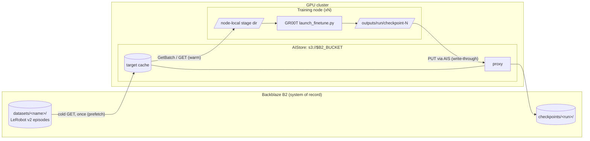

# GR00T Robotics Training on Backblaze B2 with AIStore

Fine-tune NVIDIA Isaac GR00T N1.7 on robot episodes stored in Backblaze B2. AIStore (AIS) stages the dataset next to your GPUs as a read-through cache, and checkpoints are written back to B2 with a verifiable manifest.

Robot-learning datasets are many small files: per-episode Parquet tables, per-camera MP4s, and JSON metadata in LeRobot v2 layout. GR00T reads them from local disk, so every job copies the dataset to the node first. Without a cache, every job and node pulls the whole dataset from B2; with AIS, B2 serves each object once per cache fill.

## Prerequisites

Steps marked **any machine** run on a CPU-only Linux or macOS host. Steps marked **GPU host** need the GPU items below.

- [ ] A B2 bucket and an application key restricted to it with `listBuckets`, `listFiles`, `readFiles`, `writeFiles`
- [ ] Docker with Compose v2 and `curl`
- [ ] [uv](https://docs.astral.sh/uv/), git, and [git-lfs](https://git-lfs.com/)
- [ ] **GPU host:** Linux x86_64 (Ubuntu 22.04+), an NVIDIA driver supporting CUDA 12.6+, FFmpeg, and one GPU with 48 GB VRAM recommended (L40S, RTX 6000 Ada, H100). GR00T documents 40 GB+ for default tuning (projector + action head); `--tune-llm` / `--tune-visual` need 80 GB+.
- [ ] **GPU host:** access to the gated [`nvidia/Cosmos-Reason2-2B`](https://huggingface.co/nvidia/Cosmos-Reason2-2B) backbone, then `hf auth login`

## Quickstart

```bash
cp .env.example .env              # any machine: fill in B2 settings and the bucket-scoped key
make setup                        # any machine: locked Python env, pinned Isaac-GR00T + demo data
make up                           # any machine: start AIS on 127.0.0.1:51080, attach s3://$B2_BUCKET
make seed                         # any machine: upload demo_data/cube_to_bowl_5 to B2
make run ARGS="--dry-run"
make setup-gpu                    # GPU host: Isaac-GR00T's own environment
make run ARGS="--max-steps 200"   # GPU host: stage via AIS, fine-tune, sync checkpoints to B2
```

| Step | Expected output |
|---|---|
| `make setup` | `git lfs pull` fetches `demo_data/cube_to_bowl_5` (~30 MB) |
| `make up` | `attached s3://<bucket> -> https://s3.<region>.backblazeb2.com (region <region>) at http://127.0.0.1:51080` |
| `make seed` | `s3://<bucket>/datasets/cube_to_bowl_5/: N uploaded, 0 unchanged` (re-runs report `0 uploaded, N unchanged`) |
| `make run ARGS="--dry-run"` | `stage:`, `train:`, and `sync:` lines with the exact GR00T command |
| `make setup-gpu` | uv finishes installing into `third_party/Isaac-GR00T/.venv` |
| `make run ARGS="--max-steps 200"` | `staged N objects ...`, `[sync] checkpoint-N: ...`, and `[stats] B2 GETs via AIS during training: 0 (0.0 MB)` |

`make help` lists every target. The demo is GR00T's own `demo_data/cube_to_bowl_5`: 5 SO-101 episodes, two cameras, LeRobot `v2.1`, run with `NEW_EMBODIMENT` and `examples/SO100/so100_config.py`. A 200-step run exercises the pipeline; GR00T's guide uses 2000+ steps for a useful policy.

## Running on a cloud GPU

Run the quickstart on a Linux GPU workstation or cloud VM with Docker and the prerequisites above. Cloud instances often have small root disks, so put the cache and the staged dataset on mounted local NVMe storage; use `lsblk` to identify the mount:

```bash
echo 'AIS_CACHE_DIR=/mnt/nvme/ais' >> .env      # AIS cache, applied on the next `make up`
make run ARGS="--stage-dir /mnt/nvme/stage --max-steps 200"
```

On Kubernetes platforms such as CoreWeave, or pods without a Docker daemon, deploy AIS with [ais-k8s](https://github.com/NVIDIA/ais-k8s) with the B2 key as its AWS backend credentials. Then set `AIS_ENDPOINT` in `.env` to its proxy and run `make attach` instead of `make up`. Keep that cluster private to the job; see [docs/operations.md](docs/operations.md).

## Architecture



| Step | Code | AIStore API |
|---|---|---|
| Attach B2 bucket | `scripts/attach_b2_bucket.sh` | REST `create-bck` on provider `aws` with `extra.aws.endpoint` / `cloud_region`, bucket feature `S3-Use-Path-Style`, cluster feature `S3-Reverse-Proxy`, then a one-object list |
| Stage to node | `aistore_b2_gr00t.storage.stage` | `ObjectGroup.prefetch` (cold), then `Client.batch(...).get()` (GetBatch); or parallel S3 GETs |
| Fine-tune | `aistore_b2_gr00t.finetune` | none; GR00T reads local disk |
| Sync checkpoints | `CheckpointSync` -> `storage.upload_dir` | S3 `PUT` / multipart through `$AIS_ENDPOINT/s3` |

**Staging.** Staging prefetches the dataset into AIS, then copies it to a fresh private temporary directory with GetBatch, which returns many objects in one ordered stream. GetBatch serves only objects already in the cluster ([docs](https://github.com/NVIDIA/aistore/blob/main/docs/get_batch.md)), so staging checks every batch for count, order, and size. `--stage-method get` uses parallel S3 GETs through AIS instead, which cold-GET on a cache miss. Staging verifies sizes and manifest hashes, then renames the complete dataset into place. The destination includes a hash of the full dataset prefix and the run identity, so datasets with the same basename never collide, and an existing nonempty destination is refused. Ordinary GETs stream to disk in bounded chunks; GetBatch buffers each object inside the SDK, so size batches and concurrency for your data.

**Checkpoints.** Checkpoints appear at `s3://$B2_BUCKET/checkpoints/<run-name>/checkpoint-N/` while training runs. The trainer (transformers 4.57.3) writes `checkpoint-N` in place, so a checkpoint is uploaded only once a newer one exists or the run exits cleanly. If the run exits non-zero or is interrupted, only checkpoints up to the second-newest are synced. A failed upload during training is logged and retried on the next sync tick; it never stops the trainer.

**Interrupts.** SIGINT and SIGTERM are forwarded to the owned training process group; workers get 30 seconds before SIGKILL. After a zero launcher exit, helpers get 5 seconds to exit on their own; a group still running then is stopped and the run is treated as incomplete, so the newest checkpoint is not published. Interrupted runs exit 130 or 143 and sync only checkpoints known to be complete. Uploads may outlast process shutdown while managed-transfer threads finish or retry.

### Publication protocol

Seeded datasets, finished checkpoints, and final run outputs are published as a prefix with a `_SUCCESS.json` record:

1. Hash every local file with SHA-256.
2. Write `_SUCCESS.json` with status `pending` and no files. This invalidates any earlier publication at that prefix before data changes.
3. Upload each object with its SHA-256 in user metadata. An object is skipped only when its size and SHA-256 already match, from metadata or a previous complete record (AIS can omit user metadata on HEAD). Multipart ETags are never used as content hashes.
4. Check that the local tree did not change during upload (paths plus size, mtime, ctime and inode; bytes are not re-read), then replace the record with status `complete`, every file's size and SHA-256, and provenance.

```json
{
  "schema_version": 1,
  "status": "complete",
  "files": {"trainer_state.json": {"size": 123, "sha256": "<64 hex characters>"}},
  "provenance": {"base_model": "nvidia/GR00T-N1.7-3B", "checkpoint": "checkpoint-200", "input_manifest_sha256": "<64 hex characters>"}
}
```

Consumers accept only schema version 1 with status `complete`, verify every listed size and SHA-256, and ignore unlisted objects, including leftovers from an earlier failed publication. `input_manifest_sha256` is the SHA-256 of the input's `_SUCCESS.json` re-serialized with sorted keys (equal to its `sha256sum` when these tools wrote it; `null` when the input has none), so each output traces to the exact input it was built from. Object stores have no atomic directory upload; the record written last is what makes a prefix safe to consume. A failed transfer leaves the record `pending`.

One writer owns each remote prefix. Default run names include a timestamp and random suffix; explicit names must be single identifiers, and existing local output directories are refused. After a failed upload, keep the source tree and retry with `storage.upload_dir(..., publish=True)`, passing the original `provenance=` so the output keeps its lineage; files that already match are skipped. If the source is lost or changed, publish under a new run name.

Each `checkpoint-N/` has its own record. The optional run-root record covers configs, logs, and any final model outside the checkpoint directories; it is not a checkpoint inventory, and a checkpoint-only run publishes none. Staging treats a dataset's complete record as authoritative and checks each downloaded hash; datasets without one get size checks only.

```bash
make verify PREFIX=datasets/cube_to_bowl_5                            # through AIS
make verify PREFIX=checkpoints/<run>/checkpoint-200 ARGS="--direct"   # B2's durable copy
```

Verification streams every listed object, checks its size and SHA-256, then rereads the record to detect a concurrent republish.

### Scope

- Training is not faster: GR00T trains from local disk either way. AIS can reduce staging time, and it reduces B2 traffic on repeat reads and gives the cluster one S3 endpoint.
- The Compose stack is a single-host demo: one proxy, one target, no authentication, ports bound to `127.0.0.1`. See [docs/operations.md](docs/operations.md) for remote deployments.
- Multi-node sharing of one AIS cluster is described below but is not covered by the tests.
- The root lock covers storage tools only; the trainer uses Isaac-GR00T's own environment.

## Configuration

| Variable | Required | Default | Purpose |
|---|---|---|---|
| `B2_ENDPOINT` | yes | | B2 S3 endpoint, e.g. `https://s3.us-west-004.backblazeb2.com` |
| `B2_REGION` | yes | | B2 region, e.g. `us-west-004` |
| `B2_BUCKET` | yes | | Bucket holding `datasets/` and `checkpoints/` |
| `B2_KEY_ID` / `B2_APP_KEY` | `make up`, seed, bench, `verify --direct` | | Bucket-scoped key |
| `AIS_ENDPOINT` | no | `http://127.0.0.1:51080` | Any AIS gateway |
| `AIS_PORT` / `AIS_TARGET_PORT` | no | `51080` / `51081` | Compose host ports (host port = container port) |
| `AIS_IMAGE` | no | digest pin | Override the AIS image |
| `AIS_CACHE_DIR` | no | Docker volume | Host path for the AIS cache, e.g. local NVMe |
| `GR00T_DIR` | no | `third_party/Isaac-GR00T` | Isaac-GR00T checkout used by `make run` |
| `HF_TOKEN` | no | | Hugging Face token for `seed_b2.py --hf-repo` |
| `B2_IT` | no | | Set to `1` to opt in to `make test-integration` |

`.env` is shell-sourced, so quote values containing spaces or `#`. Unit tests never source it.

`make run` options: `--dataset-prefix`, `--run-name`, `--checkpoint-prefix` (default `checkpoints`), `--stage-dir` (node-local disk), `--output-dir`, `--stage-method getbatch|get`, `--embodiment-tag`, `--modality-config-path`, `--num-gpus`, `--max-steps`, `--sync-interval`, `--dry-run`, then `-- <GR00T args>`. Anything after `--` goes to `launch_finetune.py` unchanged, e.g. `ARGS="-- --use-wandb --save-steps 500 --global-batch-size 64"`. The wrapper reserves dataset, output, base-model, GPU-count, and `--experiment-name` flags so checkpoint sync watches the right directory. `--num-gpus N` uses `torchrun --standalone` on one node, so concurrent jobs on a host get distinct rendezvous ports. `--num-gpus 1` keeps only the first device in an inherited `CUDA_VISIBLE_DEVICES`. See `uv run python -m aistore_b2_gr00t.finetune --help`.

**Larger dataset.** `unitree_g1.LMPnPAppleToPlateDC` is one task from GR00T-X-Embodiment-Sim (CC BY 4.0, 103 episodes, 213 files, ~375 MB, LeRobot `v2.1`). It matches GR00T's pre-registered `UNITREE_G1` tag, so no modality config is required:

```bash
set -a; . ./.env; set +a
uv run --locked python scripts/seed_b2.py --hf-repo nvidia/PhysicalAI-Robotics-GR00T-X-Embodiment-Sim \
  --revision ea7ac0b68f87da62f1e726771bba0fe74300802f \
  --allow-pattern 'unitree_g1.LMPnPAppleToPlateDC/**' \
  --source-subdir unitree_g1.LMPnPAppleToPlateDC \
  --prefix datasets/unitree_g1.LMPnPAppleToPlateDC
make run DATASET_PREFIX=datasets/unitree_g1.LMPnPAppleToPlateDC \
  ARGS="--embodiment-tag UNITREE_G1 --modality-config-path ''"
```

Use a new immutable prefix for each dataset revision; overwriting inputs in B2 can leave old data in the AIS cache.

**Multiple nodes.** Sharing a cache across nodes needs a reachable AIS cluster, e.g. [ais-k8s](https://github.com/NVIDIA/ais-k8s). Each node sets `AIS_ENDPOINT` to that cluster and uses a distinct run name. These are independent training jobs, not ranks of one distributed job. Concurrent prefetches retry missing objects once.

## Benchmarks

```bash
make bench ARGS="--stagers 4 --repeats 3"
make bench ARGS="--method get"            # parallel GET instead of GetBatch
```

`benchmarks/stage_time.py` times copying one dataset prefix to local disk three ways:

| Mode | What happens | B2 GETs reported |
|---|---|---|
| `b2-direct` | Parallel S3 GETs straight to B2 | data GETs this client issued |
| `ais-cold` | Objects evicted from AIS, then staged through AIS | measured AIS backend GETs |
| `ais-warm` | Untimed fill, then staged from the AIS cache | measured AIS backend GETs |

`B2 GETs` / `B2 GET MB` are totals over all timed repeats. AIS modes report the change in the cluster's `aws.get.n` / `aws.get.size` counters, including cold manifest reads; `b2-direct` counts its own data GETs. Listings and HEADs are not counted. Every mode includes the same listing, verification, and manifest work in its wall time, so this is an end-to-end staging comparison.

- `--stagers N` runs N concurrent stagers, each into its own directory, to approximate N nodes starting together.
- `--workers N` sets transfer and prefetch concurrency per stager; the default is 16 for GET/prefetch and 4 for GetBatch, which buffers objects in memory.
- Reports include median wall time, aggregate MB/s, p50/p99 request latency, host, CPU count, and TCP RTT to B2 and AIS, written to `results/stage_time-<timestamp>.{json,md}` (change with `--out-dir`). Record link bandwidth alongside.
- Run from a node in the GPU cluster, against your real B2 region, on an otherwise idle AIS cluster. On Linux, drop the page cache between runs: `sync && echo 3 | sudo tee /proc/sys/vm/drop_caches`. This repository publishes no numbers.

Without a cache, B2 GETs scale with objects x nodes x jobs; with AIS, with objects per cache fill. Price them with the current [B2 pricing page](https://www.backblaze.com/cloud-storage/pricing) and reconcile with B2 reports.

## Tests

```bash
make check              # lint + offline unit tests (what CI runs, Python 3.10 and 3.12)
make test-integration   # real B2, opt-in
```

Integration tests run against real B2 through a disposable AIS cluster under its own Compose project on ports 51180/51181, started cold and removed with its cache on exit. They cover attach, cold GET, GetBatch and GET staging of the demo data (byte-identical), zero B2 GETs on warm restages (AIS backend counters), checkpoint write-through including multipart, the benchmark, and the full `finetune` flow with a stub trainer. Requirements:

- a dedicated test bucket and a key scoped to it with `listBuckets`, `listFiles`, `readFiles`, `writeFiles`, set in `.env` with `B2_IT=1`;
- a B2 lifecycle rule on prefix `it/`: each run writes under a unique `it/<timestamp>-<hex>/` prefix and deletes nothing;
- Docker and git-lfs, with ports 51180 and 51181 free.

## Security

- Use a bucket-scoped key with only `listBuckets`, `listFiles`, `readFiles`, `writeFiles`. AIS writes through, so an AIS delete of an `s3://` object also deletes it in B2; leave out `deleteFiles`.
- Only the AIS target container and the direct-to-B2 tools (seed, benchmark, `verify --direct`) receive the B2 key. `make run` removes the B2 variables from the trainer's environment; training-only hosts need no backend credentials.
- AIS runs without authentication and accepts placeholder S3 credentials, so keep the stack on localhost. Remote deployments need AuthN and TLS; see [docs/operations.md](docs/operations.md).
- Object keys are untrusted. Staging refuses traversal, absolute paths, path aliases, and symlinks inside the staging tree; temporary staging trees are private to the current user. Uploads reject symlinks inside the tree. `--stage-dir` and `--output-dir` may themselves be symlinks (e.g. to local NVMe); they are resolved once at startup.
- `.env` is git-ignored and secrets are excluded from `Config` repr.

## Troubleshooting

| Symptom | Fix |
|---|---|
| Port 51080 in use on `make up` | Set `AIS_PORT`, `AIS_TARGET_PORT`, and `AIS_ENDPOINT` in `.env`. |
| `create-bck failed` or `AIS cannot list s3://...` from `make up`, often `ErrRemoteBckNotFound` | Check `B2_ENDPOINT`, `B2_REGION`, `B2_BUCKET`, and the key's capabilities, then re-run `./scripts/attach_b2_bucket.sh` with `.env` loaded (idempotent). |
| `split-brain` in proxy logs after recreating containers | Proxy state lives in the `proxy_conf` volume. Reset with `docker compose -f deploy/docker-compose.yml down -v`; this drops the cache, not B2 data. |
| `GetBatch returned k/n objects` | The objects were evicted after prefetch. Re-run, or use `--stage-method get`. |
| `Git LFS pointer files` from `make seed` | Install git-lfs, then `make setup`. |
| `install git-lfs first` from `make setup` | Install [git-lfs](https://git-lfs.com/) and re-run. |
| `CUDA_HOME is unset` / flash-attn errors | GR00T environment issue; see the [Isaac-GR00T installation guide](https://github.com/NVIDIA/Isaac-GR00T/tree/n1.7-release#installation). |
| 401/403 from Hugging Face during training | Request access to `nvidia/Cosmos-Reason2-2B` and run `hf auth login` on the training node. |

## Pins

| Component | Pin |
|---|---|
| Isaac-GR00T | tag `n1.7-release`, commit `23ace64f17aa5015259b8609d371eb61a357c776` enforced by `make setup`; base model `nvidia/GR00T-N1.7-3B` |
| CPU Python environment | `uv.lock` |
| AIStore image | `aistorage/cluster-minimal:v5.1`, pinned by digest in `deploy/docker-compose.yml` |
| AIStore Python SDK | `aistore==2.0.0`, moves with the image |
| Seed dataset (larger) | `nvidia/PhysicalAI-Robotics-GR00T-X-Embodiment-Sim` @ `ea7ac0b68f87da62f1e726771bba0fe74300802f` |

Record the driver, CUDA, and model revisions for each experiment.

## Licenses and disclaimer

| Item | License | In this repo |
|---|---|---|
| Sample code | Apache-2.0 ([LICENSE](LICENSE)) | yes |
| `deploy/docker-compose.yml` | Adapted from AIStore (MIT); notice in [NOTICE](NOTICE) | yes |
| Isaac-GR00T code and `demo_data` | Apache-2.0 | no, cloned by `make setup` |
| GR00T N1.7 weights | NVIDIA Open Model License per the [model card](https://huggingface.co/nvidia/GR00T-N1.7-3B); check the model page before commercial use | no, downloaded on first use |
| Cosmos-Reason2-2B | NVIDIA Open Model License (gated) | no, downloaded on first use |
| GR00T-X-Embodiment-Sim dataset | CC BY 4.0, attribution NVIDIA | no, seeded to your bucket |

This is a Backblaze sample. It is not affiliated with, sponsored by, or endorsed by NVIDIA. NVIDIA, Isaac, GR00T, Cosmos, and AIStore are trademarks of their respective owners.
